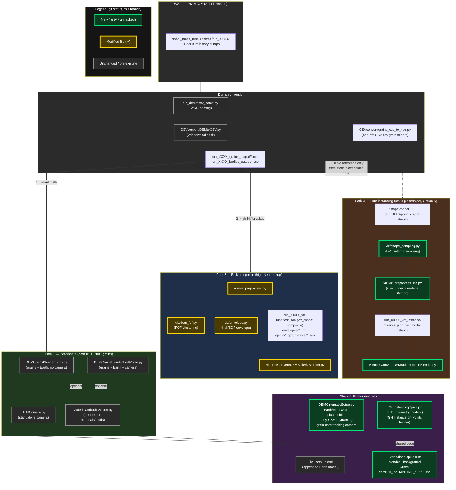

# Blender visualisation pipeline — flow diagram

> **Dated snapshot (2026-09-11). Partly stale:** converter is now `DEMDumpConvert.py` (not `DEMtoCSV.py`); instancing is no longer static-only (`viz_preprocess_grains_instance.py` feeds per-frame real grains); `DEMHeadlessRender.py` + WSL TUI not shown. Current: WSL `docs/SHARED_FACTS.md`, `../CLAUDE.md`.

Generated by Claude Code on 2026-09-11. Shows current data flow from WSL PHANTOM
dumps through conversion (bodies CSV, grains npz) into all three Blender viz paths (per-sphere, bulk
composite, pure instancing) and the shared modules between them.

## Notes

- **Node colour = git status on `spike/option-a-gn-instancing-p0`** (checked
  2026-09-11): green = new file (`A`/untracked — `DEMBulkInstanceBlender.py`,
  `DEMCinematicSetup.py`, `viz/shape_sampling.py`, `viz/viz_preprocess_lite.py`,
  `P0_InstancingSpike.py`); yellow = modified pre-existing file (`M` —
  `DEMBulkVizBlender.py`, `viz/dem_fof.py`, `viz/envelope.py`,
  `viz/viz_preprocess.py`); grey = unchanged on this branch (the per-sphere
  scripts, `DEMtoCSV.py`/`run_demtocsv_batch.py`, `TheEarth1.blend`). This
  reflects one point-in-time `git status` snapshot, not permanent authorship —
  re-check before relying on it once these changes are committed.
- **Source formats (since 2026-09-13):** grains are one `.npz` per dump
  (`np.load`), bodies stay one CSV per dump. Grain folders converted before
  then were CSV; `grains_csv_to_npz.py` added a same-stem `.npz` beside each
  grain CSV (CSVs kept). Readers use only the `.npz`.
- **Edge style source → path** encodes how each path actually consumes the
  source files: the thick "1"/"2" arrows into Path 1 and Path 2 are real
  per-frame data dependencies; the dotted "3" arrow into Path 3 is a
  one-time scale reference only (`viz_preprocess_lite.py` reads frame 1 of
  the grain npz / bodies CSV once, to size a static point cloud — it does not
  ingest per-frame motion, see the static-placeholder note below).
- All three viz paths share the same source folders (`grains_output`/
  `bodies_output`) but differ in exactly what they read from them:
  `DEMCamera.py` reads only the grain npz (it tracks the grain core in a scene
  that `DEMGrainsBlenderEarth.py` already built); the per-sphere importers pair
  each grain `.npz` with the same-stem bodies CSV. Per-sphere needs no
  preprocessing step, while the other two write an intermediate
  `_viz`/`_viz_instance` folder with a `viz_mode`-tagged manifest that the
  corresponding Blender script checks before running.
- `DEMCinematicSetup.py` was extracted from `DEMBulkVizBlender.py` specifically
  so `DEMBulkInstanceBlender.py` could reuse the same Earth/Moon/Sun/camera
  code rather than duplicating it — it's the one module both bulk paths
  depend on.
- `DEMBulkInstanceBlender.py` also calls into
  `P0_InstancingSpike.build_geometry_nodes()` to build its GN point-cloud
  instancer, so the "benchmark" script isn't purely standalone — it doubles
  as a reusable module, even though it's *also* runnable headless on its own
  (`blender --background --python P0_InstancingSpike.py`) for the
  GN-instancing cost-curve spike that writes `docs/P0_INSTANCING_SPIKE.md`.
- The pure-instancing path is currently a **static placeholder only** (one
  shape-sampled point cloud held fixed across all frames) — that's a
  data/behavior fact rather than something the diagram shows structurally,
  worth keeping in mind when reading the `INSTANCE` subgraph.
